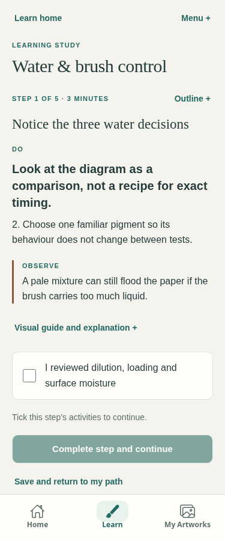
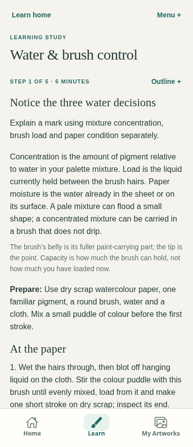
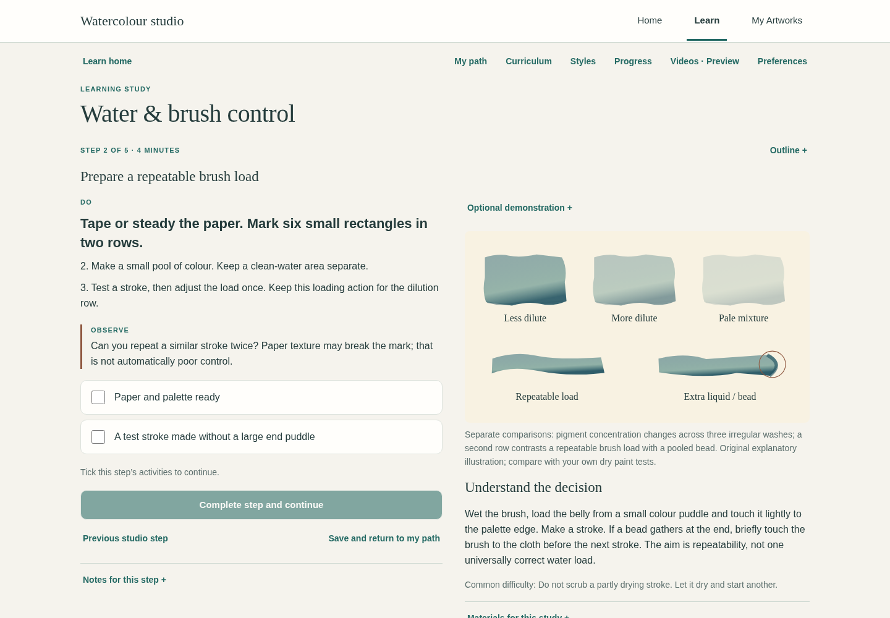
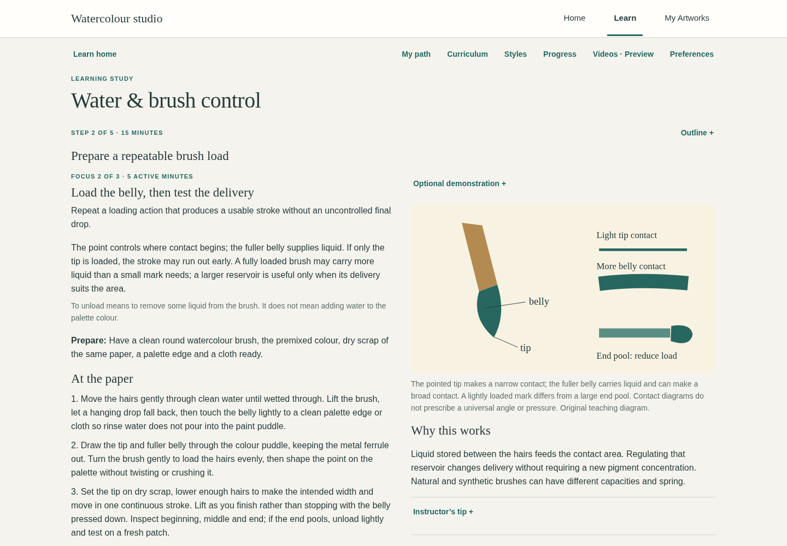

# Water & Brush Control: integrated teaching pilot

## Baseline and scope

Fetched remote `main` on 4 November 2026: `c2c5dd7468e3c0a25c9b6009ff035ca8cbe0f741`, unchanged from the reviewed PR #41 release. The working tree was clean. Source inspection confirms four lessons, one eight-step project, 27 canonical steps, 12 framework modules, 24 skills, 17 preview candidates, 18 proposed windows and zero approved media resources.

The baseline supplies useful short comparisons but gives little detail on wetting/loading the whole brush, the physical contact of tip and belly, joining wash passes, or how to distinguish similar-looking failures. Mobile hides the short concept paragraph with its diagram. Related research previews require leaving the lesson. These are teaching and integration gaps, not evidence that the existing curriculum or saved records should be replaced.

## Implemented architecture

`instructionTypes.ts` defines additive teaching units, controlled experiments, conditional diagnostics and a separate provisional-video link type. `waterInstruction.ts` authors the pilot. `instruction.ts` validates identities, canonical references, order, diagnostics, time totals and evidence-bound preview links. These are not `MediaResource` objects and cannot satisfy publication checks.

The canonical lesson route renders a selected focus within each existing step in this reading order: learning goal → essential concept/terms → preparation → sequenced physical actions → optional contextual preview → observation → controlled experiment → symptom guide → original practice record → next focus. Essential instructions stay visible on mobile. Symptom guides have one disclosure per symptom, without an enclosing diagnosis disclosure. A separate visual/reference column supplies original diagrams, fuller causal explanation, tips, optional related diagnosis and variations; mobile retains an independent visual-guide disclosure. Experienced self-reported learners can fold basic terminology and see the decision variation directly. All essential written teaching remains present for video-preferring learners.

Teaching-focus navigation is reading state, not a second course or completion mechanism. On web, explicit choices are retained in `sessionStorage` under `watercolor:teaching-focus:v1:<account>:<lesson>:<step>`; each value is only a validated existing unit ID. Refresh and returning in the same tab restore that focus, without loading media. Account/step changes use separate keys. Blocked storage falls back to in-memory navigation, and unknown/removed IDs fall back to the first focus. The existing learner-progress schema, storage and data are untouched. Native retains in-memory selection only. Tab closure normally ends session storage; this is not cross-device or durable progress.

| Canonical step | Implemented focuses | Active estimate |
| --- | --- | --- |
| `look` | Three independent water decisions; controlled load comparison | 5 min |
| `set-up` | Materials and working size; loading the round brush; contact and movement | 15 min |
| `dilution` | A connected flat wash; two rows comparing dry concentration | 15 min |
| `moisture` | Surface stages; dry/damp comparison; a safe diagnostic repeat | 15 min |
| `reflect` | Dry comparison, observed relationship, uncertainty and transfer | 5 min |

Total: approximately **55 active minutes** (18 reading, 37 practice), with individual focuses of 3–8 active minutes. Watching and material-dependent drying are additional. The original short comparison remains available for short visits. Nothing forces a timer or automatic advance.

## Representative teaching changes

Before, setup says: “Wet the brush, load the belly from a small colour puddle and touch it lightly to the palette edge.”

The added loading focus explains how to wet through the hairs, avoid a dry interior or hanging drop, bring the tip and belly through the premixed colour, test the beginning/middle/end of a stroke, unload lightly and repeat on fresh scrap. It explicitly separates changing the brush’s liquid reservoir from diluting the palette mixture.

Before, the drying warning says: “Do not scrub a partly drying stroke. Let it dry and start another.”

The diagnostic guide now connects a lighter bloom and darker rim to possible water imbalance, asks whether sheen was already disappearing or an edge pool fed back, proposes a fresh one-variable comparison, and says when to leave the original passage alone. It also recognises intentional blooms and texture.

Before, mobile’s “Do” list led directly to a checklist while the concept was optional. The initial PR pilot also placed its first action and original checklist too early. Final owner-directed revision places the learning goal, concept and preparation before every physical action, then keeps video/observation/experiment together and puts the original checklist after troubleshooting. The checklist records only the original activities; focus navigation adds no mandatory gates.

## Technical accuracy and instructional coherence

The sequence is: distinguish controls → arrange materials → establish delivery → compare contact → connect a wash → vary concentration → read the surface → compare conditions → diagnose a fresh test → reflect and transfer. Each focus includes an explicit transition. No three-value or advanced urban video is represented as brush-loading evidence.

Original diagrams distinguish the three controls, tip/belly contact, an advancing wet join/small bead and dry/damp/standing-water conditions. They are labelled teaching diagrams, not physical paintings, footage or quantitatively simulated pigment behaviour. Their text alternatives explain both the concept and its limitation.

No fixed brush angle, mixture ratio, inclination or drying duration is prescribed. Brush size/shape/hair, actual load, paper sizing/texture/thickness, pigment concentration/properties and room conditions affect results. A wet sheen and internal dampness are distinguished. Soft edges, lost contours, lifting, softening and glazing are not interchangeable. Granulation, neutral colour, diffusion and broken texture are not automatically mistakes. Corrections to wet pools are conditional; uncertain or partly drying passages are left alone.

### Two challenged learner scenarios

1. **Small wash flooded by a wet brush:** the learner checks for a hanging drop, standing water and incline. Only if the passage remains wholly wet does the guide suggest touching the excess pool with a clean blotted brush. When sheen is disappearing, it says to stop. The next scrap test changes load or incline separately, keeping concentration steady.
2. **Unintended backrun after a late wet touch:** the learner checks the earlier surface state and nearby pools, leaves the forming bloom alone, and tries a fresh comparison with earlier timing *or* more comparable delivery. The guide explicitly avoids scrubbing or repeatedly adding water. An expressive bloom can remain if it serves the intention.

These are inspected instructional decision paths, **not reports of physically performed painting trials**. An instructor/owner must still assess how a real beginner applies them.

### Explicit self-review

Reviewer: Codex author/self-review; no independent instructor approval. Every one of the ten units is assessed against all ten categories in the machine-readable [validation record](mentor-grade-watercolour-instruction-validation.json). PASS means evidence supports the bounded claim below, not artistic certification.

| Category | Self-review outcome and basis |
| --- | --- |
| Technical accuracy | NEEDS HUMAN REVIEW: consistent with inspected manufacturer principles; detailed application still needs instructor/owner judgement. |
| Physical specificity | PASS based on inspected authored actions: brush contact, delivery, surface, observation and stop decisions are stated. |
| Causal clarity | PASS based on inspected concept/why/experiment fields; hypotheses remain conditional. |
| Learner-level suitability | NEEDS HUMAN REVIEW: terminology and experienced variations are present, but no human learner study occurred. |
| Continuity | PASS based on inspected transitions, canonical ordering and reference validation. |
| Practical reproducibility | NEEDS HUMAN REVIEW: controlled variables/constants and outcomes exist; no physical paint trials were performed. |
| Diagnostic correctness | NEEDS HUMAN REVIEW: plausible alternatives and safe stops are explicit; no appearance-only certainty or universal repair. |
| Material variation | PASS based on inspected normal-variation, dry-comparison and material caveats. |
| Accessible presentation | PASS for the executed browser/keyboard/reflow scope in the validation record; full WCAG conformance is not claimed. |
| Video/evidence alignment | PASS for references and honest provisional labels; exact footage matching remains open. |

### Inspected supporting sources

Fetched successfully with normal certificate-verified HTTPS on 4 November 2026; source prose was inspected, not merely a search snippet. No passages, photographs or video frames are reproduced.

- [DANIEL SMITH / Carmen Gardner: Four basic watercolor washes](https://danielsmith.com/tutorials/extra-fine-watercolors/four-basic-watercolor-washes/) — prepared puddle, wet/dry starting approaches, reloading, wet-edge continuity, excess liquid and stopping. Its particular materials/board angle are examples, not mandatory prescriptions in this lesson.
- [DANIEL SMITH: Watercolor for beginners](https://danielsmith.com/tutorials/watercolor-for-beginners/) — tip/full-brush use, water containers, palette/cloth, wet-on-dry/wet-on-wet, pigment properties, glazing, lifting and dry appearance. The pilot adds cautious material-dependent comparisons rather than assuming every pigment and sheet behaves alike.
- [YouTube IFrame API](https://developers.google.com/youtube/iframe_api_reference), [player parameters](https://developers.google.com/youtube/player_parameters), [API terms](https://developers.google.com/youtube/terms/api-services-terms-of-service) — official object-form cue/load, absolute endpoints, `seekTo` invalidating end restrictions, minimum 200×200 viewport, controls/origin and privacy obligations. Existing official-player implementation is reused; no legal certification is claimed.

## Inline media and remaining evidence

The [machine-readable crosswalk and exact 27-step rollout](mentor-grade-watercolour-crosswalk.json) records every unit’s outcome, exercise, illustration, reference, source window, provenance and unresolved inspection.

- **Steve, `alq0YqX86gs`, 47–702s:** two teaching points reference the **same longer owner proposal**. Neither is described as a separately verified loading/wash clip. Actual actions and shorter boundaries still need inspection.
- **Louise, `UeIHo83pVGc`:** surface-reading context can open the owner’s **90s start-only** proposal without an end. The dry/damp comparison separately references publisher hints **109–410s** and **515–758s**. These are chapter proposals, not certified clips.
- No video is assigned to reflection. All six existing no-video steps remain protected. No softening video is claimed to prove a lost contour. The Café 138s conflict is not used; all candidates/hints, Paul and all three Javid records remain unchanged in discovery.

One explicit inline Watch mounts the existing `PreviewVideoPlayer` with the exact reference ID/window, using the existing official frame/controller. Multiple references share one active selection. Opening another, switching focus/step, opening approved media or leaving the route disposes the old frame. Closing focuses the current physical experiment; no playback event writes a checklist, note or completion. Replay restores absolute boundaries; seeking remains approximate. Third-party connection waits for a deliberate gesture; official controls/ads/branding and external original links remain accessible.

No new live YouTube/footage diagnostics were attempted. Browser video frames are synthetic API responses. Availability, narration, actual captions, exact action matching and final clip approval remain unverified. The approved catalogue is still empty. Private owner review and JSON export remain in their separate library mode.

## Saved work and safe rollout

No lesson ID, step ID, checklist ID/wording, version, storage key/schema, reflection, completion rule, provider, auth, Supabase/RLS, quota, artwork assessment or production source lock changes. A snapshot regression compares all five canonical item contracts against fetched `main`. Old partial work resumes its canonical step and, when available, that account’s tab-session reading focus. Completed work retains its reflection and completion, with an explicit note that extended teaching did not reassess it.

Only timing and a safer fresh-test/short-session summary change in the canonical Water & Brush record. The other three lessons and project content are unchanged. No migrations, dependencies, paid AI calls, learner uploads, merge or deployment.

Next rollout is editorially gated, not automated bulk expansion:

1. **Three-value planning:** observed grouping → connected masses → contrasting alternatives → dry/distance comparison → reflection. Preserve every existing step/checklist; verify Paul’s actual grouping sequence before an exact clip.
2. **Edges:** hard → soft → genuinely lost relationships with moisture/value controls. Keep the lost-contour demonstration gap open until inspected evidence exists.
3. **Observed structure:** envelope/proportion → related edges/horizon → controlled simplification → transfer. Verify Tim’s actual explanation before offering exact segments; Javid remains optional advanced comparison.
4. **Eight-step landscape:** retain `intention`, `values`, `wash-plan`, `sky`, `hill`, `bank`, `finish`, `reflect`. Enrich decisions and conditional diagnosis per stage; preserve drying/resume and keep intention/reflection video-free. Review focal decisions as choices, not mandatory darkening/detail.

Owner review is needed for technical/learner suitability, real physical failure scenarios, and whether the related footage actually supports each proposed teaching point. Do not repeat the four already supplied clarity/fit screenings. No exact clip is approved by reviewing this UI.

## Focused final instructional and editorial review — 4 November 2026

Reviewed every field of all ten units and every symptom/cause/check/correction/stop/material-variation field of the eight diagnostic guides. [Per-unit and per-guide decisions](mentor-grade-watercolour-editorial-followup.json) distinguish author review from instructor approval. The five existing video links and their evidence classifications were compared byte-for-byte against the initial PR head; no footage inspection or new approval occurred.

Corrections of substance:

- Loading now regulates residual rinse water **before** taking colour, loads both point and reservoir without submerging the ferrule, and describes moving/lifting at the end rather than parking a loaded belly on the sheet.
- Contact comparison holds a similar hand angle and speed while gently changing pressure/contact area. Turning the brush onto its side is a separate variation. Fast skipping is distinguished from a reservoir actually running out.
- Wash passes explicitly move across and down the rectangle, overlapping the freely wet lower edge. A prominent bead is optional on a level sheet. Excess removal requires the entire passage to remain freely wet and a rinsed, blotted brush; repeat touches require renewed blotting.
- Dilution starts from comparable shares of one well-mixed stock. Rinsing/blotting between concentrations avoids uncontrolled carry-over water. Dry values, rather than wet gloss, determine the comparison.
- The second moisture patch is prepared when needed, rather than assumed to remain damp while the first stroke is painted. An unevenly drying patch is replaced with fresh test space. Observation-only and painted comparisons are separate exercises.
- Diagnostic repeats change one cause at a time. Pooling cleanup cannot spread into a setting wash; an exhausted stroke is tested at the original length before a separate shorter test. Reflections describe an observed relationship rather than certifying a cause from one sample.

Navigation now focuses the selected explanation instead of leaving focus on a removed button or scrolling to the whole page’s top. “Return to practice” still closes video and focuses the same experiment. “Back to explanation” provides a local return. The next focus names its destination and transition. The focus chooser is secondary, after the practice record; no reload warning or repeated competence disclaimer interrupts the teaching.

The earlier first-viewport action/checklist tests expressed the old action-first design and contradict the owner’s requested concept-first sequence. Their acceptance criteria now require the goal first, uncollapsed essential instruction in order, a reachable final checklist above fixed navigation, and the existing no-overflow/touch/contrast/navigation thresholds. They are not silently skipped. Before/after screenshots retain the original baseline; the updated after views and [review captures](screenshots/mentor-instruction/) show the revised order.

Review limitation: this is an explicit author/self-review supported by source inspection and synthetic browser acceptance, not independent artistic certification or a physical learner trial. Instructor judgement on handling/material variation, Android Chrome use and real footage matching remains open. No new screening questions are requested.

## Screenshots and validation

[Executed commands, counts and limitations](mentor-grade-watercolour-instruction-validation.json). Captures are the actual exported app with synthetic accounts, original diagrams and simulated provider frames; they contain no private artwork or copied footage.

| View | Before | Implemented pilot |
| --- | --- | --- |
| Mobile lesson |  |  |
| Desktop lesson |  |  |

[Initial PR pilot mobile](screenshots/mentor-instruction/before-final-review-mobile.png) · [Initial PR pilot desktop](screenshots/mentor-instruction/before-final-review-desktop.png) show the action/checklist-first order that prompted this final correction. The after column above shows the corrected pilot.

Follow the actual revised sequence: [goal/concept/preparation](screenshots/mentor-instruction/reading-order.png) → [brush instructions](screenshots/mentor-instruction/brush-physical-sequence.png) → [inline preview before loading](screenshots/mentor-instruction/inline-before.png) → [synthetic player](screenshots/mentor-instruction/inline-synthetic.png) → [painting exercise](screenshots/mentor-instruction/practice.png) → [diagnosis](screenshots/mentor-instruction/diagnosis.png) → [final practice checklist and next focus](screenshots/mentor-instruction/final-practice-checklist.png).
