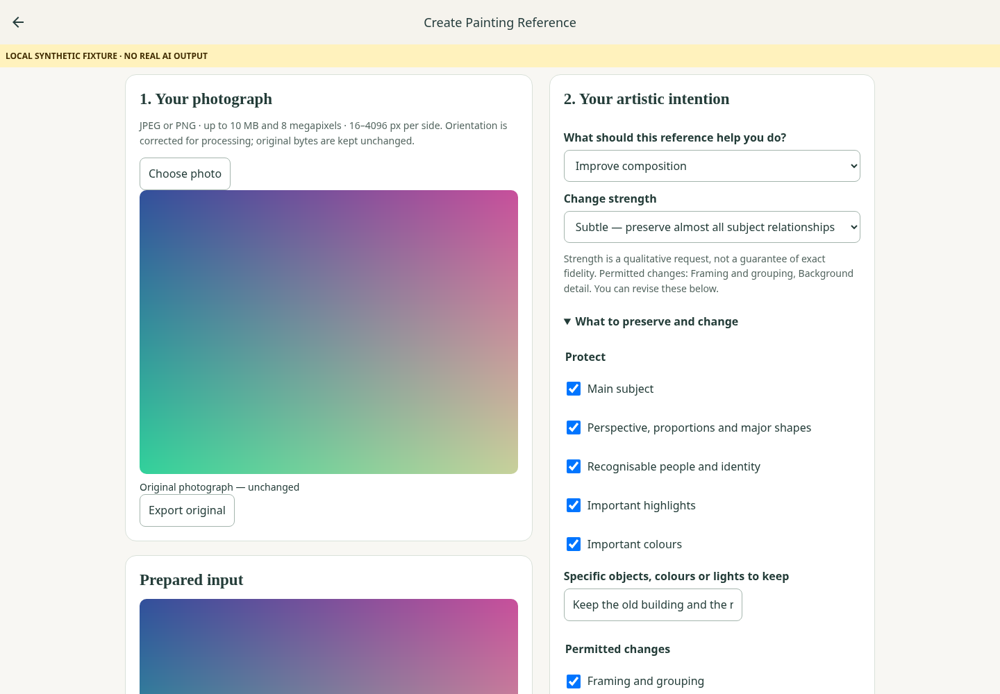
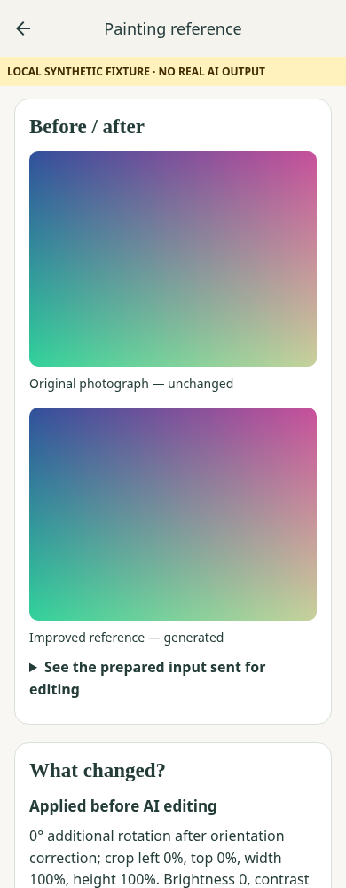
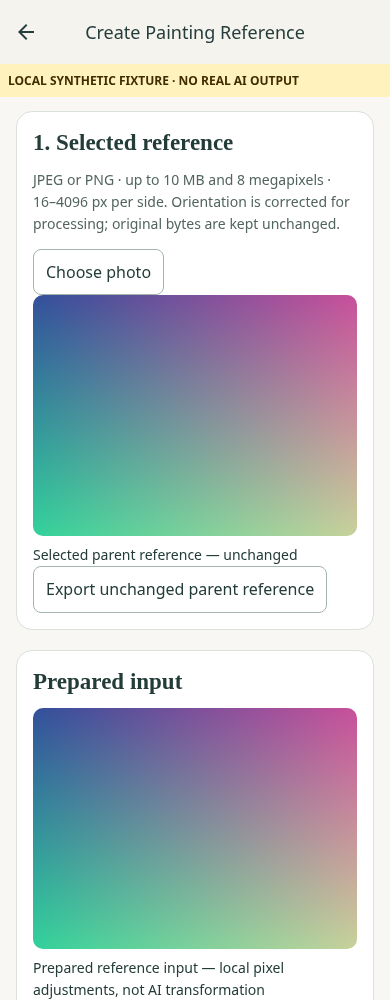

# Reference Studio — actual exported app

These are Chromium captures of the configured Expo export, with a synthetic account and intercepted backend responses. A visible yellow banner says **LOCAL SYNTHETIC FIXTURE · NO REAL AI OUTPUT**. Pixel inputs/outputs are original deterministic fixtures, not photographs or provider image edits. No production account, live provider, paid call or private photograph was used. This is engineering evidence, not artistic-fidelity evidence or a physical Android test.

- [01-upload-mobile.png](01-upload-mobile.png): source picker and disabled paid action.
- [02-local-preparation-mobile.png](02-local-preparation-mobile.png): original/local prepared image.
- [03-value-study-mobile.png](03-value-study-mobile.png): actual computed/exportable pixel groups.
- [04-artistic-controls-desktop.png](04-artistic-controls-desktop.png): intention and preserve/change controls.
- [05-generating-mobile.png](05-generating-mobile.png): one held, simulated request; duplicate action disabled.
- [06-reference-result-desktop.png](06-reference-result-desktop.png): prominent fixture result, no real AI output claim.
- [07-comparison-mobile.png](07-comparison-mobile.png): original/generated-fixture comparison.
- [08-planning-result-mobile.png](08-planning-result-mobile.png): computed five-value study from fixture result.
- [09-painting-guidance-desktop.png](09-painting-guidance-desktop.png): conditional guidance and export.
- [10-uncertain-request-mobile.png](10-uncertain-request-mobile.png): status-only recovery without regeneration.
- [11-saved-reference-mobile.png](11-saved-reference-mobile.png): privately saved-record reopening.
- [12-enlarged-text-mobile.png](12-enlarged-text-mobile.png): enlarged text/reflow.
- [13-refinement-source-mobile.png](13-refinement-source-mobile.png): generated parent identified as a reference rather than a new photograph.

Screenshots are produced by `tests/browser/reference-studio.cjs`. It also checks seven widths, keyboard focus, original-byte preservation, actual PNG export, separate paid consent, refinement lineage, no automatic rerun, no old feedback endpoint and account isolation. The validation JSON identifies the actual executed run. No screenshot certifies the provider's ability to preserve people, buildings, objects or artistic intent.

Representative captures (fixtures, not real AI output):

## Final staging preparation follow-up

Actual exported Expo app at 390px mobile and 1440px desktop. All source/output images are local deterministic fixtures; there was **no real image-provider request or paid grant**. The displayed allowance 4 is a browser fixture, not the one-attempt staging plan. The old receipt-loss reproduction screenshot comes from the prior configured export; its caption here identifies the fixture even though that failure capture predates the banner injection on that page.

- [Before: unresolved receipt cleared](staging/before-receipt-cleared-fixture.png). The new browser assertion fails against this previous export.
- [After: unresolved receipt retained](staging/14-receipt-retained-mobile.png). No new generation occurs.
- [Zero allowance, local tools remain usable](staging/15-no-allowance-mobile.png).
- [Server preparation rejection suggests a smaller copy](staging/16a-smaller-photo-advice-mobile.png).
- [Unreadable prior request keeps its receipt](staging/16-preparation-rejection-mobile.png).
- [Approval-only export, mobile](staging/17-request-approval-mobile.png).
- [Approval-only export, desktop](staging/18-request-approval-desktop.png).

Inspected text wrapping, touch targets, full button names, readable error/receipt recovery and no horizontal overflow. Browser emulation does not certify physical Android Chrome or actual output fidelity. The proposed real source-photo bytes remain outside the repository and were not sent for generation.
