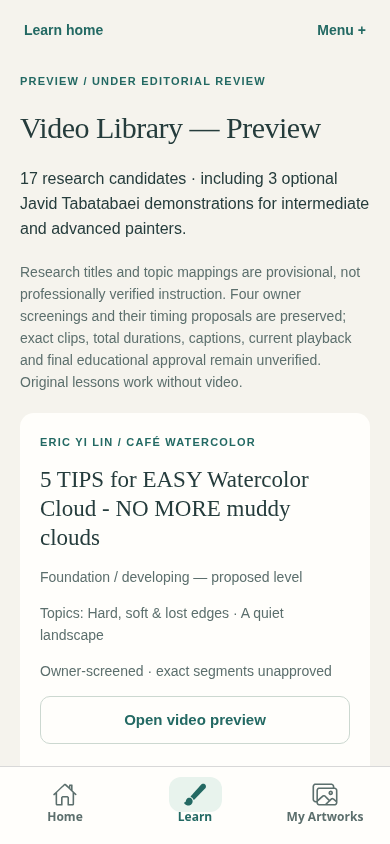
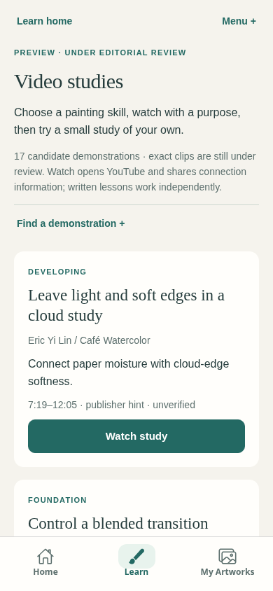
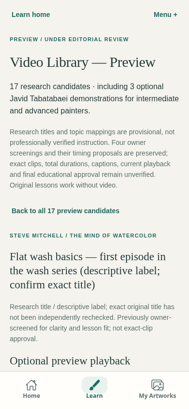
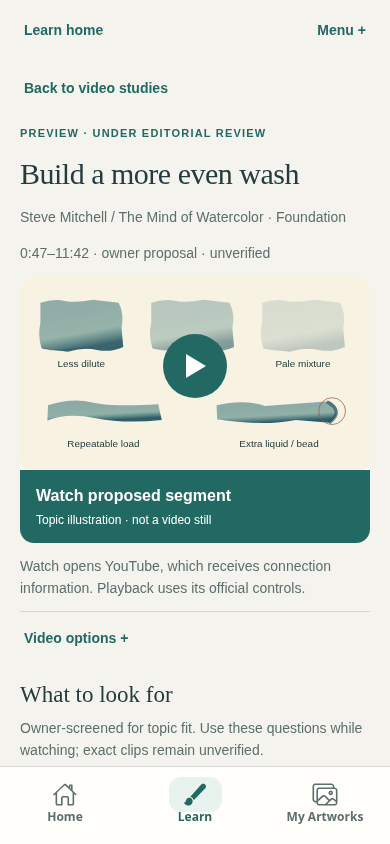
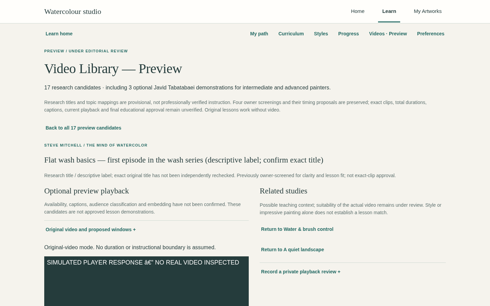
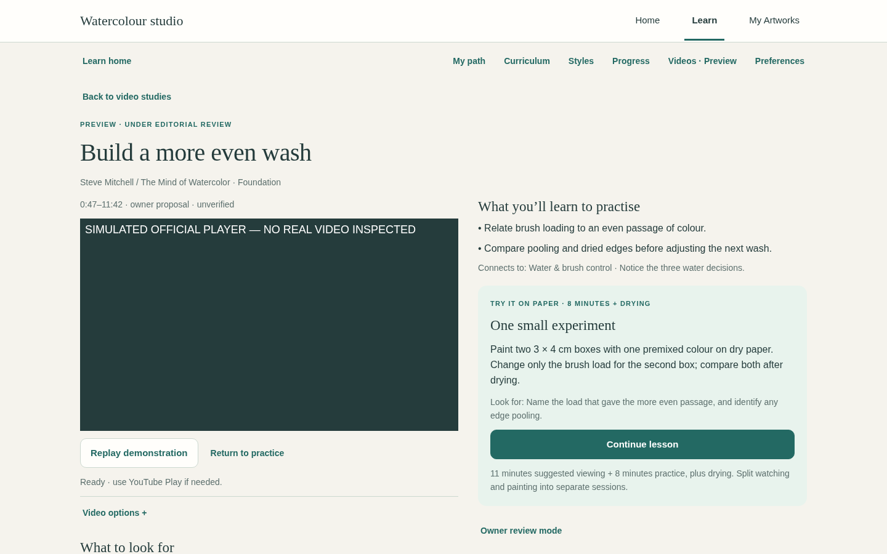

# Video studies: learner UX review

This focused change starts from deployed `main` at `787a07e57928a47fc8d657eb847e61ba533b5eaa`. It is a new review branch; no merge, deployment or production data operation is included.

## What changed and why

| Reproduced cause in the deployed implementation | Revised behaviour |
| --- | --- |
| Every selection resets to `original`; a second Load button stands between a library choice and YouTube. | One Watch choice opens the existing official player and requests playback. Direct links and reloads still wait for a Watch gesture. Browser restrictions may require YouTube’s own Play control; a request is never reported as actual playback. |
| Available owner proposals are hidden behind a chapter disclosure. | Steve defaults to 47–702s; Paul to 37–852s; Louise to the owner’s 90s start with no invented end. A mapped Louise moisture/hard/soft step selects the corresponding publisher hint instead. |
| Café’s chapter endpoints conflict. | The broad cloud study uses the non-conflicting 439–725s practice hint; soft-edge context uses 1068–1251s. Neither 138s alternative is a default or a learner chapter choice; both remain intact in owner mode. All hints are unverified. |
| Seventeen descriptive research titles expose little practical teaching. | All 17 have an original educational title, suggested learner level, 2 objectives, 2 observation questions, one controlled physical exercise and observable success criteria. Proposed viewing time and practice time are separate; long/unknown viewing is not squeezed into a short session. |
| Review fields, caption QA and long research caveats compete with painting. | A separate explicit Owner review mode contains the unchanged private review/save/recovery/JSON tools and optional caption-preference tests. Normal learners use YouTube’s own CC menu. Secondary playback/terms/privacy controls are under Video options. |
| A long undifferentiated list offers little guidance. | Curriculum topic and level filters, current-lesson access, and deterministic ordering by exact study, level and learning goal preserve access to every candidate. All three Javid videos remain optional advanced comparisons. |
| Leaving video offers no direct transition to a physical action. | Return to practice pauses and removes the frame, scrolls to and focuses the exercise. Continue lesson resumes the existing stored lesson step; video never completes it. |

`learning/videoLearning.ts` contains the original app guidance and evidence-aware defaults. It does not import private owner notes, creator transcripts or raw research files. The unchanged research catalogue retains all 17 identities, four owner screenings, 18 proposed windows/hints and all existing curriculum mappings. Profile-based ordering is a preview discovery aid, not a claim that these videos passed instructional approval.

## Actual screen comparisons

These are captures of the exported app with synthetic accounts and simulated provider responses. The before app is the exact archived Pages artifact for the baseline above. No video footage or private painting is pictured. Same-width examples are supplied; the before/after mobile captures use 390 × 844 and desktop uses 1440 × 900.

| Screen | Before | After |
| --- | --- | --- |
| Mobile library |  |  |
| Mobile selected study |  |  |
| Desktop studio |  |  |

The Watch poster reuses original local teaching diagrams, explicitly labelled “Topic illustration · not a video still”. It makes no third-party thumbnail request and claims no creator artwork rights. The poster is removed before the official player appears; no custom overlay covers YouTube controls, branding or ads.

## Validation and limits

Exact completed checks are recorded in [the validation record](learner-video-ux-validation.json). The browser suite exercises the real export, including gesture-only loading, every default, all 17 original links, absolute boundaries, switching, replay, captions as preferences, keyboard activation, seven widths, enlarged-text reflow, errors, cleanup, private-review separation and failure recovery, and unchanged learner progress. Existing learning, assessment and isolated approved-player regressions are checked separately.

Real YouTube playback, exact instructional boundaries, caption tracks, narration and artistic teaching accuracy are **not** newly verified. No cloud network re-probe or TLS bypass was attempted. An uninspected candidate explicitly presents a *suggested* viewing focus; even the four previously screened entries are not exact-clip approvals. The independently authored practice is useful without playback, but its match to the footage remains subject to owner/editorial review. Native external linking is preserved; physical Android/iOS, actual OS keyboard and human usability testing are not claimed.

The approved lesson catalogue remains empty. This PR neither publishes clips nor changes editorial, technical, audience or explicit owner-approval gates. Authentication, Supabase/RLS, quota/idempotency, artwork assessment, storage keys/schema and saved work are unchanged. No dependencies, credentials, paid AI calls, uploads, backend/schema changes, merge or deployment.

Owner review should focus on the mobile Watch → Observe → Practise flow, whether each suggested exercise fits the real footage, and whether provisional chapter choices are useful. Approving this UI does not automatically approve a candidate as lesson media.
